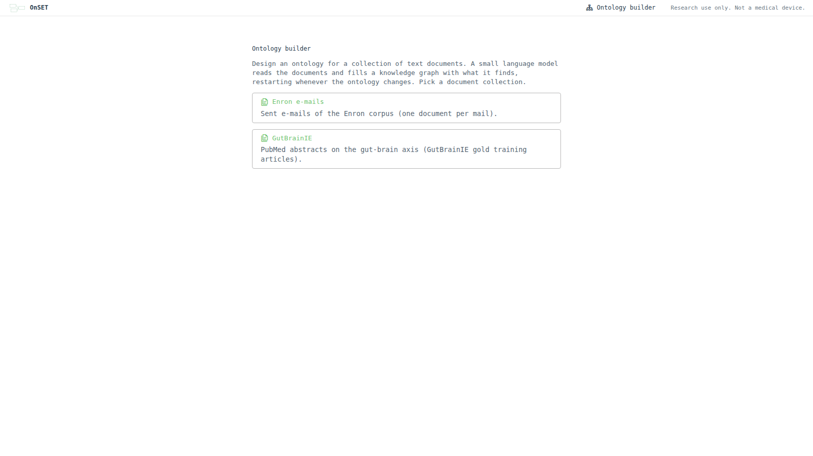
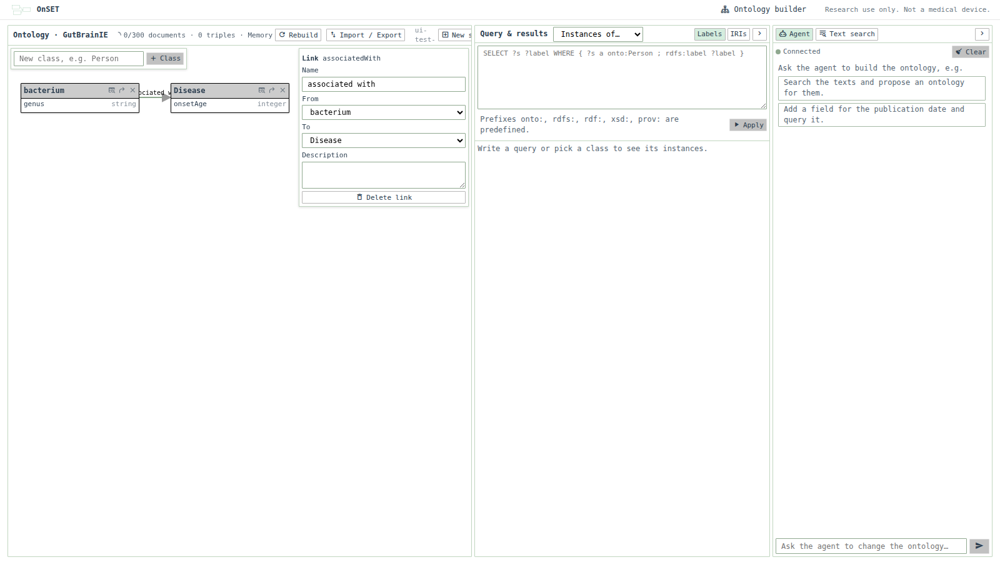
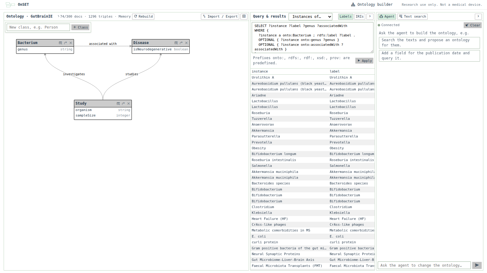
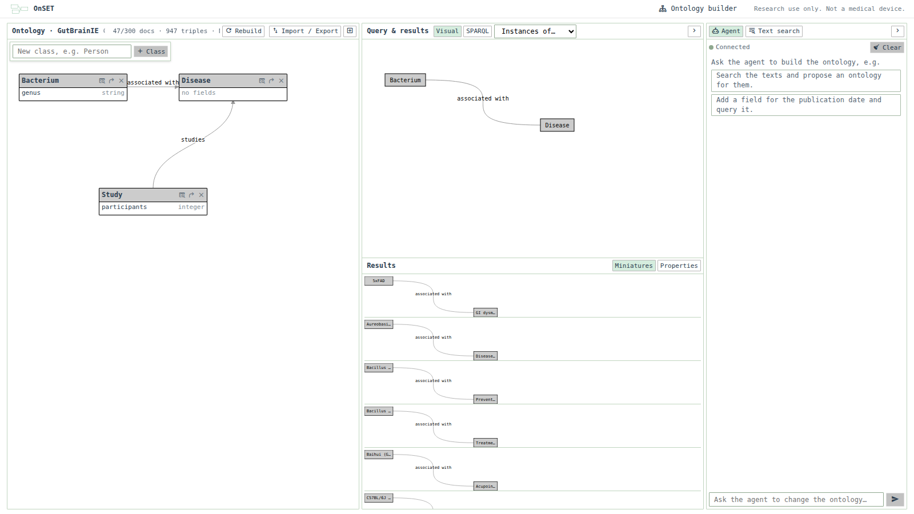
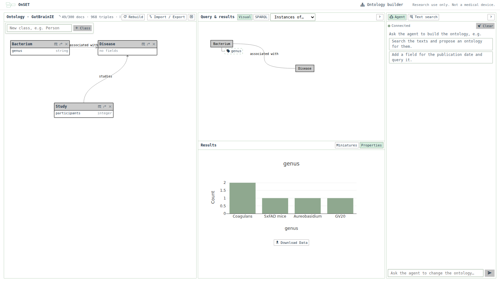
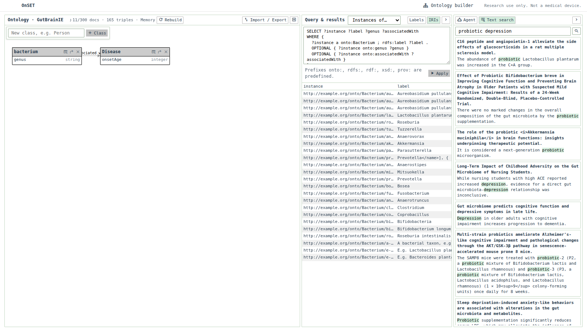
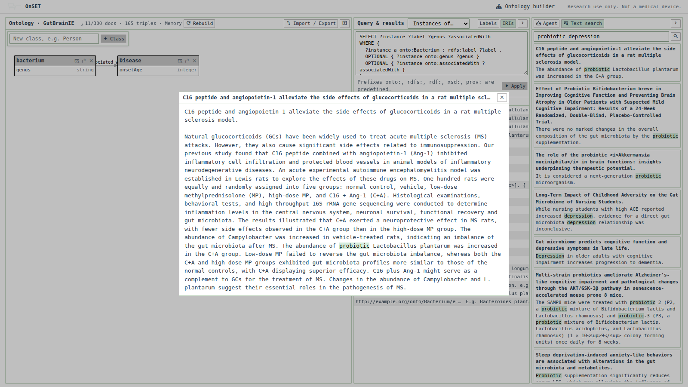
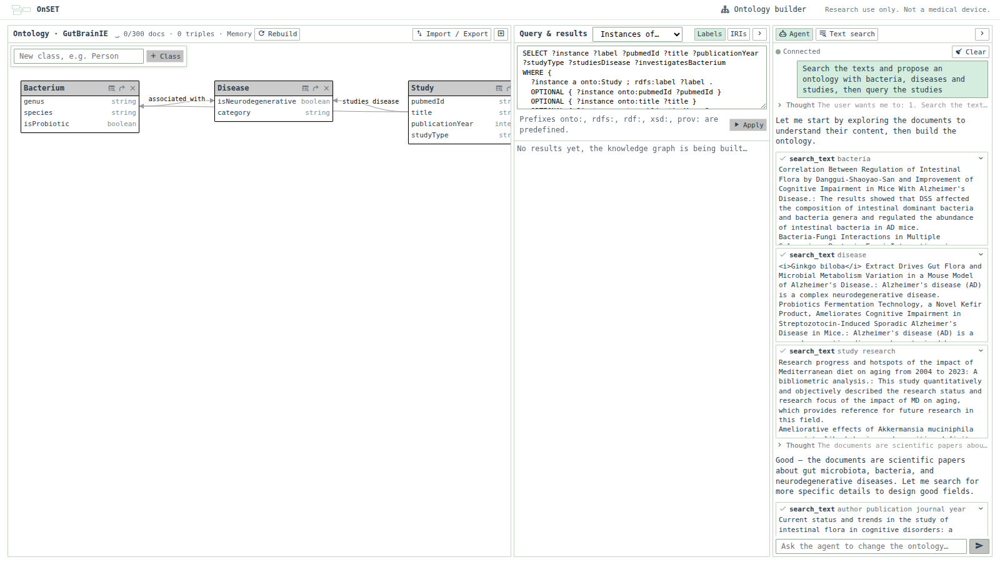
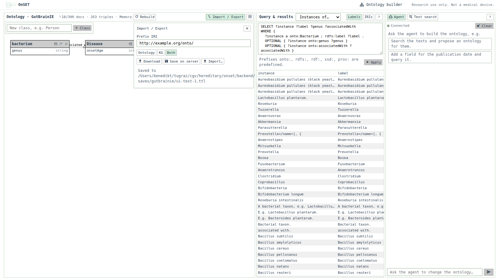
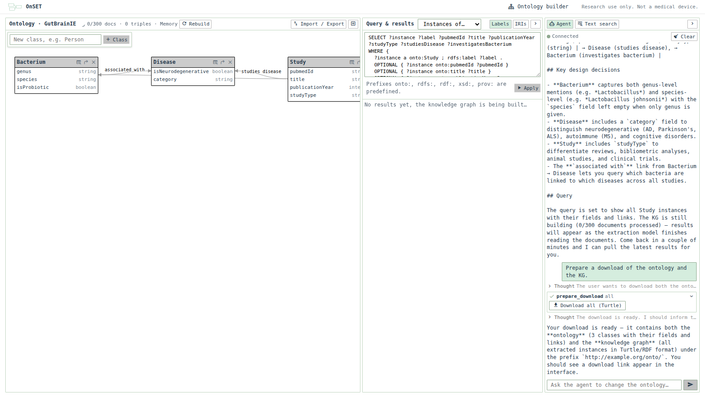

# Ontology Builder Demo

The ontology builder (`/onto-builder`) helps you design an ontology for a collection of text documents. While you edit the ontology, a small constrained language model reads the documents and fills a knowledge graph (KG) with what it finds. You query that KG live, so you can judge quickly whether the ontology fits the data. An agent can search the texts, change the ontology and the query, and prepare exports.

The screenshots below show the GutBrainIE PubMed abstracts. They were taken with the 300-document setting (`ONSET_BUILDER_MAX_DOCUMENTS=300`).

## Running it

```bash
# backend (from backend/src); AGENT_LLM_API_KEY goes into the untracked backend/.env
uv run python -m uvicorn api:app --port 8123
# frontend
cd frontend && npm run dev     # then open http://localhost:5174/onto-builder
```

The `builders` section of `backend/config.json` configures the builders:

- **Enron:** the sent mails in `data/text-sets/enron/maildir`, one document per mail.
- **GutBrainIE:** the gold training articles in `data/text-sets/gutbrainie`.

`ONSET_TEXT_SETS` moves the data directory, and `ONSET_BUILDER_MAX_DOCUMENTS` limits the number of documents per builder (default 2000).

On first use, the extraction model ([LFM2-350M-Extract](https://huggingface.co/LiquidAI/LFM2-350M-Extract), GGUF via llama.cpp) is downloaded from the Hugging Face Hub. On a laptop CPU it reads about one document every 3–4 s.

## 1. Pick a document collection



The start page and the header link to `/onto-builder`, which lists the configured builders. Every builder keeps its own session in the browser. The `+` button in the builder's header starts a new session.

## 2. Edit the ontology



The left panel is the old query editor, repurposed for the ontology:

- **Classes:** type a name in the top-left box to add a class. Each class card lists its fields with their types (string, integer, float, date, boolean, vector).
- **Inspector:** click a card to rename the class, edit its description (the extraction model reads it), or add, retype and remove fields.
- **Links:** the arrow button on a card starts a link to another class. Click a link to edit its name, source, target and description.
- **Layout:** drag cards by their header. The layout is saved with the session.

Every change is sent to the backend. A change to the schema (names, types, links or prefix) restarts the KG build.

## 3. Watch the KG fill and query it



**The header** shows the build progress: documents read, triples extracted, errors and the triple store in use. The store is Tentris on x86_64 Linux and rdflib's in-memory store elsewhere.

**The middle panel** holds the query and its results, and collapses to a narrow strip. It has two modes:

- **Visual:** the query editor of the explore view. "Instances of…" and the table button on each card start a query with that class; add links and fields from the points around a class. The instances (or, for fields, a plot) show below.
- **SPARQL:** the query as text with a result table. Here "Instances of…" and the table button generate a query for a class, with its label, fields and links. A query the agent sets is shown in this mode.
- The prefixes `onto:`, `rdfs:`, `rdf:`, `xsd:` and `prov:` are predefined.
- Results refresh while the build runs, and the table switches between labels and IRIs.

In visual mode, a query from `Bacterium` along *associated with* to `Disease` lists each matching pair as a miniature:



Adding the `genus` field to `Bacterium` plots its values:



In the SPARQL screenshot at the top of this section, 74 of 300 abstracts have been read. The results already show the extractor's mistakes, such as *Obesity* extracted as a `Bacterium`, so you can see early whether a class description needs to be sharper.

Every instance carries:

- an `rdfs:label`, its name
- `prov:wasDerivedFrom` its source document
- its fields and links

## 4. Search the texts



The *Text search* tab ranks the sentences of all documents (TF-IDF) and shows only the matching snippet per document, with the query terms highlighted. Clicking a snippet opens the full document:



## 5. Let the agent build it



The *Agent* tab chats with a tool-calling LLM (`agent` in `config.json`). Its tools:

- **Ontology:** `get_ontology`, `add_class`, `remove_class`, `add_field`, `remove_field`, `add_link`, `remove_link`
- **Text:** `search_text`, which returns a few snippets, not whole documents
- **Query and results:** `set_query`, `query_class`, `get_results`
- **Export:** `prepare_download`

Here, asked to *"Search the texts and propose an ontology with bacteria, diseases and studies, then query the studies"*, it searches the abstracts and builds `Bacterium`, `Disease` and `Study` with fields and links. It then sets the query for the studies.

Its changes go through the same session as manual edits, so the editor, the build and the results update while it works.

## 6. Import, export and save



The *Import / Export* dialog:

- **Prefix IRI:** settable. Ontology terms and instances are rewritten to the new prefix on export.
- **Content:** the ontology (OWL classes, datatype and object properties with domains and ranges), the KG, or both.
- **Download** a Turtle file.
- **Save on server:** writes the TTL plus the session (ontology with layout and query) to `backend/builder-saves/<builder>/<session>`. The session is restored from there after a restart.
- **Import** a TTL file. Its OWL/RDFS classes and properties become the ontology, and its instance triples are kept in the KG.

The agent can prepare a download as well:



## Known limits

- The 350M extraction model is fast but makes mistakes: misclassified entities, and missed fields and links. Names that leak markup or copy the ontology's own descriptions are dropped. Sharp class descriptions help, but avoid "e.g." examples in them, because the model tends to copy them.
- Every schema change restarts the extraction from the first document. A session nobody has looked at for 60 s pauses its build, since all sessions share the extraction model.
- Instances are merged by class and name across documents. There is no further entity resolution.
- Native Tentris only ships for x86_64 Linux. On macOS and arm64, the store falls back to rdflib's in-memory store, and sessions don't survive a backend restart unless they were saved.
