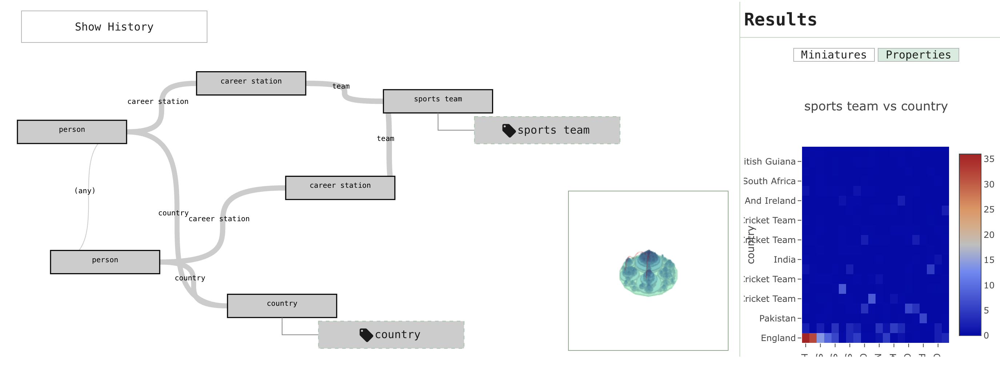

# OnSET

[](https://doi.org/10.1145/3726302.3730148)
[](https://doi.org/10.5281/zenodo.17606868)
[](LICENSE)

Code for *OnSET: Ontology and Semantic Exploration Toolkit*, presented at ACM SIGIR 2025 (demo track).

[Demo](https://onset.cgv.tugraz.at/) · [Paper](https://doi.org/10.1145/3726302.3730148) · [Video](https://www.youtube.com/watch?v=Q2ZeioBnfhQ)



> **Research use only. Not a medical device.** See [DISCLAIMER.md](DISCLAIMER.md) for intended use, data provenance and limitations.

## Overview

OnSET lets researchers explore and query ontologies and knowledge graphs (KGs) without writing SPARQL, and get a quick impression of the scale and structure of an unfamiliar KG. It has three main views:

* a **query view**, where users build queries from topics or from a natural-language prompt and refine them in a visual node-link editor,
* an **explorative view** of the ontology as a whole, its sparse relations and its named instances, and
* a **linked view** showing the class hierarchy and the topic model side by side.

For natural-language queries, a language model running locally on the server (via llama-cpp-python) extracts a prototype query graph. A grammar generated from the ontology restricts it to classes and relations that exist in the KG; the graph is then editable and runs as SPARQL against a [QLever](https://github.com/ad-freiburg/qlever) endpoint.
OnSET calls no hosted LLM API. On first start, the backend downloads the language model and the sentence-embedding models from the Hugging Face Hub.

## Data

The repository contains no knowledge-graph data. The `docker/*-data` folders hold [QLever](https://github.com/ad-freiburg/qlever-control) configurations (`Qleverfile`) that download and index public KGs, each under its own licence:
[DBpedia](https://www.dbpedia.org/) (`docker/dbpedia-data`, the default backend configuration),
UniProt (`docker/uniprot-data`),
the [BRAINTEASER Ontology](https://zenodo.org/records/12789731) (`docker/bto-data`),
YAGO (`docker/yago-data`), DNB (`docker/dnb-data`), DBLP (`docker/dblp-data`) and Olympics (`docker/olympics-data`).
The backend configurations for each KG (SPARQL port, database, model) are in `backend/src/eval_config.py`.

## Running locally

### Docker

PostgreSQL (with pgvector/PostGIS), pgAdmin and Redis run via Docker Compose:

```bash
cd docker/onset-data
docker compose up -d
```

The compose file uses development default credentials (`postgres`/`postgres`); change them before exposing the services.
The frontend and backend each have a `Dockerfile` (`frontend/Dockerfile`, `backend/Dockerfile`, the latter built with CUDA support); QLever is not part of the compose file and is started as below.

### Development setup

1. Install [Apache Jena](https://jena.apache.org/documentation/fuseki2/) so that the `riot` command-line tool is available (some `get-data` steps use it).
2. Install [qlever-control](https://github.com/ad-freiburg/qlever-control) (`pip install qlever`), then download, index and start a KG from its folder, e.g. `docker/dbpedia-data` (port 7012, the backend default):
   ```bash
   qlever get-data
   qlever index
   qlever start
   ```
3. Start the auxiliary databases (see [Docker](#docker) above).
4. Backend:
   - install [`uv`](https://docs.astral.sh/uv/getting-started/installation/),
   - install dependencies from `backend/` with `CMAKE_ARGS="-DGGML_CUDA=on" uv sync` (or `CMAKE_ARGS="-DGGML_METAL=on" uv sync` on macOS),
   - start the API from `backend/src` with `uv run python -m uvicorn api:app --reload --port 8001`. The database tables are initialised on first start. `DB_CONN_STR`, `SPARQL_ENDPOINT`, `LLM_MODEL_ID`, `LLM_MODEL_QUANT` and `REDIS_CACHE_URL` override the configured defaults.
5. Frontend:
   ```bash
   cd frontend
   npm install
   npm run dev
   ```
   The frontend reads the backend URL from `ONSET_API_BASE_URL` (`frontend/.env.development`: `http://localhost:8001`).

## Citation

```bibtex
@inproceedings{2025-onset,
  author    = {Kantz, Benedikt and Innerebner, Kevin and Waldert, Peter and Lengauer, Stefan and Lex, Elisabeth and Schreck, Tobias},
  title     = {{OnSET: Ontology and Semantic Exploration Toolkit}},
  booktitle = {Proceedings of the 48th International ACM SIGIR Conference on Research and Development in Information Retrieval},
  series    = {SIGIR '25},
  pages     = {3980--3984},
  year      = {2025},
  publisher = {Association for Computing Machinery},
  address   = {New York, NY, USA},
  isbn      = {9798400715921},
  doi       = {10.1145/3726302.3730148}
}
```

## Acknowledgement

<picture>
  <source media="(prefers-color-scheme: dark)" srcset="figures/funded-by-the-eu-dark.png">
  
</picture>

Funded by the European Union under grant agreement No 101137074 ([HEREDITARY](https://hereditary-project.eu/)).
Views and opinions expressed are however those of the author(s) only and do not necessarily reflect those of the European Union or the European Health and Digital Executive Agency (HaDEA).
Neither the European Union nor the granting authority can be held responsible for them.

## License

MIT, see [LICENSE](LICENSE).
